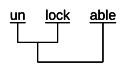
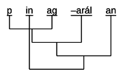

# DiagSap
DiagSap is a tool to create Philippine-style word diagrams (DiagSap is short for "diagramang sapin-sapin" which is Tagalog for "layered diagram.")

DiagSap can be used to produce diagrams such as the following:

## Website

The website for it is at [https://software.sil.org/diagsap/](https://software.sil.org/diagsap/).

## Samples
A zip file containing some sample descriptions is available [HERE](https://drive.google.com/file/d/1Ci13NeW0PGXN_w3xOBPIhgN2jjciB0D7/view?usp=sharing).
